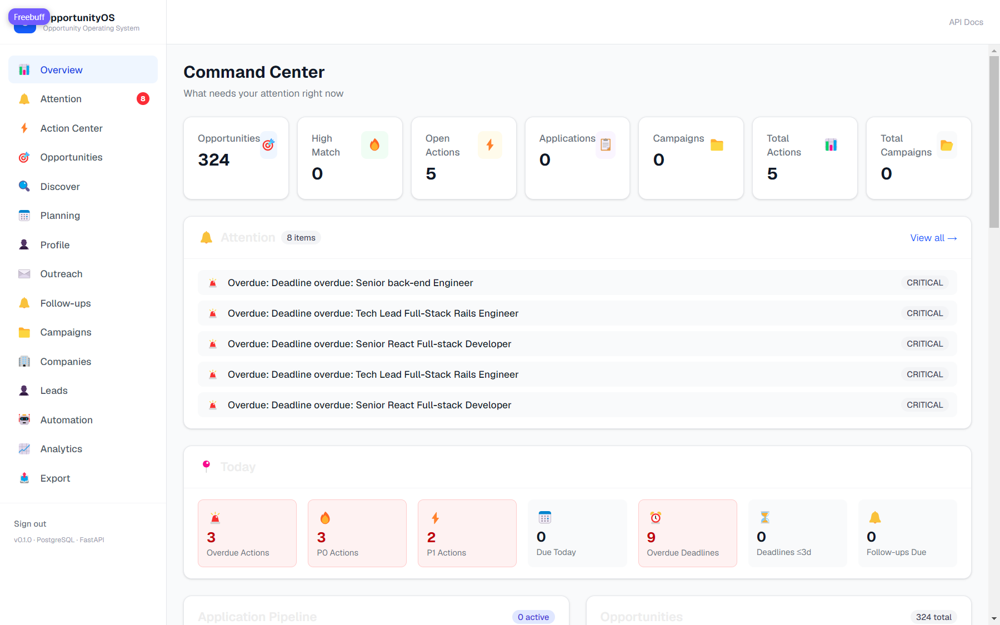
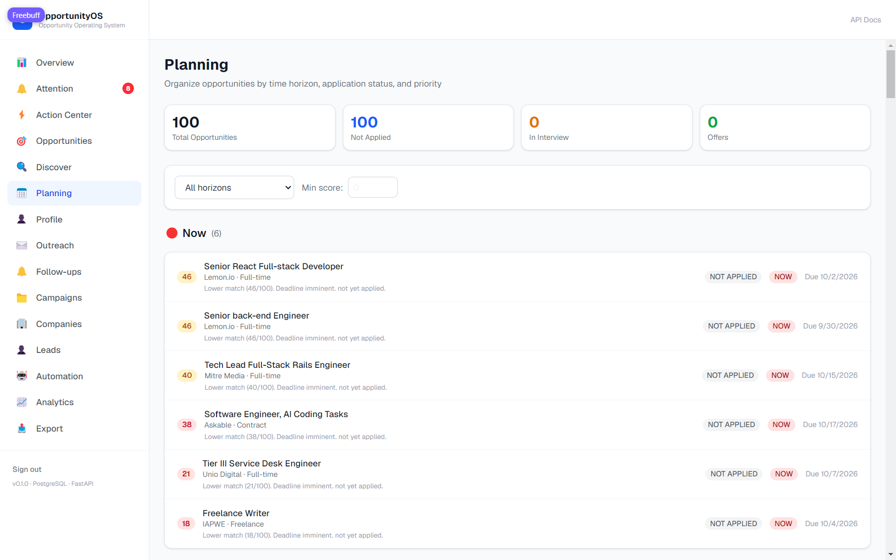
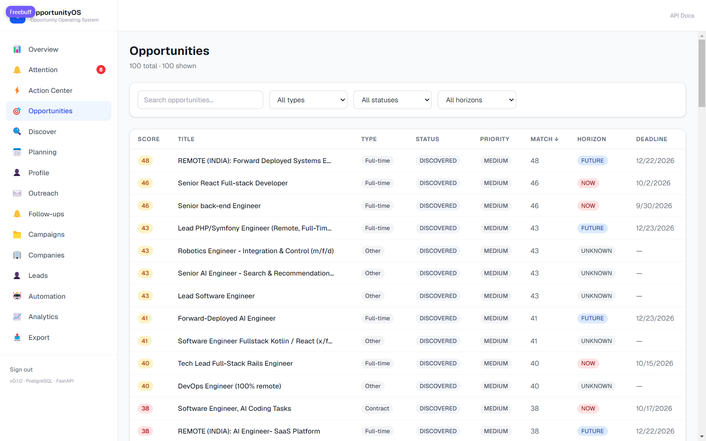
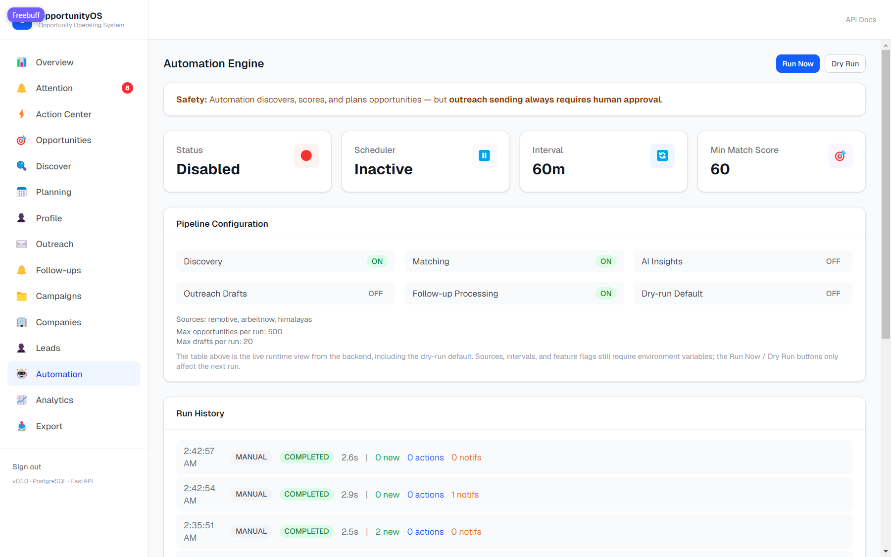

# OpportunityOS

<p align="center">
  <strong>Your operating system for finding, evaluating, and acting on opportunities.</strong>
  <br />
  <em>One place to discover opportunities, understand their fit, prepare your next move, and manage the entire journey.</em>
</p>

<p align="center">
  
  
  
  
  
  
</p>

---

## The problem

Opportunities are scattered across job boards, company career pages, research programs, startup communities, referrals, competitions, and personal networks. Keeping track of them is fragmented work: searching, comparing requirements, figuring out who to contact, tailoring materials, remembering follow-ups, and learning which approaches work.

**OpportunityOS turns that fragmented work into one structured, explainable workflow.**

It is a personal opportunity command center—not a job scraper or a spreadsheet. It takes you from *“I might be interested in this”* to *“I understand it, know why it fits, have a plan, and know what to do next.”*

## Product vision

```text
PROFILE & PREFERENCES
        ↓
DISCOVER → NORMALIZE → DEDUPLICATE
        ↓
MATCH → EXPLAIN → RESEARCH
        ↓
PRIORITIZE → PLAN → PERSONALIZE
        ↓
PREPARE → REVIEW / APPROVE
        ↓
AUTHORIZED ACTION → TRACK
        ↓
FOLLOW UP → ANALYZE → LEARN
```

Define what matters to you, let OpportunityOS organize and evaluate relevant opportunities, review its recommendations, and keep every application, conversation, and next action in one place.

## Screenshots

Real data from the running application — full set and context in [docs/evidence/screenshots](docs/evidence/screenshots/README.md).

| Command Center | Planning by horizon |
|---|---|
|  |  |

| Ranked opportunities | Automation run history |
|---|---|
|  |  |

## What kinds of opportunities?

OpportunityOS is built around a broad opportunity model, not limited to a single job board, location, role, or season.

- **Careers:** internships, graduate roles, full-time roles, startups, and product-company positions.
- **Research:** research internships, labs, academic programs, and collaborations.
- **Independent work:** freelance projects, consulting, contracts, and client leads.
- **Growth:** hackathons, fellowships, competitions, communities, and relevant collaborations.
- **Networking:** referrals, hiring-team outreach, founder conversations, and professional follow-ups.

Targeting is configurable: India-first, city-specific, remote, or worldwide. Timing can balance immediate opportunities with future cycles such as Summer 2027 without hiding a strong opportunity available now.

## Current capabilities

Implemented, tested, and verified — every row below is exercised by the automated suites and the live end-to-end workflow described in [Verification](#verification).

| Area | Current foundation |
|---|---|
| Opportunity discovery | Pluggable source-adapter architecture, with Remotive, Arbeitnow, and Himalayas adapters fetching live data |
| Normalization & deduplication | Consistent opportunity model; external-ID-first dedup verified idempotent on re-ingestion (322 listings, 0 duplicates) |
| Company association | Discovered opportunities linked to company records |
| Matching | Deterministic, explainable 0–100 scoring with matched skills, gaps, and concerns; profile preferences move scores as expected |
| Optional AI insights | Structured insights that complement—not replace—the deterministic matching result |
| Planning | Deadline-aware horizons (NOW / UPCOMING / SUMMER_2027 / FUTURE / UNKNOWN), separate from match score |
| Applications | Application lifecycle, transitions, and chronological timeline events |
| Action Center | Prioritized, idempotent action generation from current workflow state |
| Outreach | Draft → pending → approved → ready → sent lifecycle; nothing sends without explicit human approval |
| Follow-ups | Follow-up lifecycle, due handling, and timezone-aware scheduling |
| Campaigns | Grouping and organization for focused activity |
| Notifications | Persistent attention items, unread state, idempotent synchronization |
| Automation | Orchestrates discovery, matching, planning, follow-ups, actions, and notifications on a configurable schedule |
| Run history | Persisted run status, durations, and summary metrics |
| Analytics | Opportunity and application analytics, conversion views, trends, campaign drill-down |
| Export | Excel workbook export for portable reporting |
| Security | Token-gated API, BFF proxy with session cookies, CSRF Origin checks, rate-limited login — see [Security architecture](#security-architecture) |
| Operations | Health/readiness endpoints, structured logging, environment configuration, PostgreSQL migrations |

### Current source integrations

- **Remotive**
- **Arbeitnow**
- **Himalayas**

Other platforms—including LinkedIn, Handshake, and JobStep—are **planned or access-dependent** until an authorized integration path is verified. Listing a platform in the roadmap does not mean a live connector exists.

## Human control is a product principle

OpportunityOS automates the work around a decision while preserving a clear, auditable boundary around external actions.

**Automated:** discovery from supported sources, normalization, deduplication, matching, prioritization, drafting, reminders, status tracking, analytics.

**Always human:** reviewing generated content, approving consequential actions, sending. The scheduler performs internal intelligence only — it never sends email, submits applications, or approves outreach. Every approval gate is enforced server-side, and outreach send is fail-closed when no email provider is configured.

The project does not bypass platform restrictions, scrape services without permission, harvest private contact data, or send messages through unauthorized bots. Credentials are never embedded in source code.

## Security architecture

```text
Browser ── HttpOnly session cookie ──> Next.js BFF (/api/bff/*) ── Bearer token ──> FastAPI
         (never sees any token)        (allowlist + CSRF + auth)   (fail-closed auth)
```

- The FastAPI bearer token exists **only server-side**; it is in no bundle, no localStorage, no network response. A value-level scan of the production bundle confirms zero secret values ship to clients ([evidence](docs/evidence/reports/bundle_secret_scan.txt)).
- Sign-in exchanges a pasted token (rate-limited, constant-time comparison) for an **HttpOnly, SameSite=Lax, Secure-in-production** HMAC-signed session cookie.
- The BFF proxies an explicit path+method **allowlist** only; unknown paths are rejected before any network call, and the upstream origin is fixed (no open proxy).
- State-changing requests require an `Origin` allowlist match (CSRF), on top of the SameSite cookie.
- **Fail closed everywhere:** missing secrets cause explicit 503s, never fallback defaults. In production, `/docs`, `/redoc` and `/openapi.json` are disabled.

The system is intentionally **single-user**: anyone who signs in has full owner access. See [docs/evidence/LIMITATIONS.md](docs/evidence/LIMITATIONS.md) and [DEPLOY.md](DEPLOY.md) for the full threat model and limitations.

## Verification

Every number comes from a real run; raw outputs are committed under [docs/evidence/reports](docs/evidence/reports/).

| Gate | Result |
|---|---|
| Backend test suite (pytest) | **1232 passed** — isolated test database, fail-loud guard, real migrations per run |
| Frontend test suite (vitest) | **93 passed** across 5 suites |
| Lint / types / build | eslint clean, `tsc --noEmit` clean, production build succeeds |
| Dependency audit | **0 vulnerabilities** |
| Bundle secret scan | **0 secret values** in client bundle |
| Live end-to-end workflow (nothing mocked) | **62/62 checks** — BFF → FastAPI → PostgreSQL → live external job sources |

The live workflow test drives the real stack over HTTP: session login and cookie flags, live discovery ingestion, dedup on re-run, deterministic scoring, preference-driven rescoring, planning horizons, outreach lifecycle with approval gates, automation run history, action-generation idempotency, and 401 on forged sessions. See [docs/evidence/VERIFICATION.md](docs/evidence/VERIFICATION.md).

## Architecture

```text
OpportunityOS/
├── apps/
│   ├── api/       # FastAPI backend, domain services, schemas, migrations and tests
│   └── web/       # Next.js frontend, BFF proxy layer, TypeScript UI and API client
├── infra/
│   └── postgres/  # Local PostgreSQL infrastructure
├── docs/
│   └── evidence/  # Verification reports, live-workflow evidence, limitations, screenshots
├── DEPLOY.md      # Deployment guide with production checklist
└── README.md
```

```text
Browser ⇄ Next.js (BFF: allowlist proxy + session cookies) ⇄ FastAPI ⇄ PostgreSQL
                                                          ↑
                                                Alembic (migrations)
```

### Technology

| Layer | Technology |
|---|---|
| Web application | Next.js, React, TypeScript |
| API | Python, FastAPI, Pydantic |
| Persistence | PostgreSQL |
| ORM & migrations | SQLAlchemy 2.x, Alembic |
| Validation & contracts | Pydantic schemas and typed frontend API models |
| Automation | Application-level orchestrator and scheduler |
| Optional AI | Provider-abstracted structured insights |
| Export | Excel workbook generation |
| Local infrastructure | Docker Compose |

### Architectural principles

1. **PostgreSQL is the source of truth.** Excel is an export format, not a competing database.
2. **Domain rules stay deterministic where correctness matters.** AI can explain and recommend; it must not override lifecycle states, approvals, verified facts, or permissions.
3. **Source adapters are replaceable.** Each provider is normalized into canonical domain records.
4. **Lifecycle changes are explicit and traceable.** Applications, outreach, follow-ups, notifications, and automation runs have structured states.
5. **Idempotency matters.** Repeated ingestion, action generation, and notification sync do not create duplicate work — verified in tests.
6. **Failure is observable.** Health endpoints, structured logs, and persistent run summaries support troubleshooting.
7. **Secrets stay out of Git.** Runtime configuration lives in ignored local environment files or deployment secrets.
8. **Tests never touch real data.** The suite runs against a dedicated database with a fail-loud isolation guard.

## The end-term product

Roadmap goals — not claims that all are implemented today.

1. **Personal profile and preferences** — canonical, editable education, skills, experience, projects, documents, and targeting preferences (foundation: profile model with preference columns and preference-driven scoring exists).
2. **Opportunity targeting** — first-class role, location, compensation, work-authorization, and timing preferences.
3. **Company and contact intelligence** — research from legitimate public sources with source provenance and verification states; unknowns stay marked unknown.
4. **Application preparation** — recommend resume variants, suggest evidence-backed edits, draft role-specific material from the user's real experience. Never invent qualifications.
5. **Personalized outreach** — distinct contextual drafts for recruiters, hiring managers, founders; tracked approvals and outcomes.
6. **Daily attention and mobile access** — concise daily brief; responsive web and installable PWA.
7. **Learning from outcomes** — measure which sources, signals, and patterns lead to replies; inform transparent, adjustable preferences.

## Development status and roadmap

1. ~~Repository audit~~ — **done**: [docs/COMPLETION_AND_DEPLOYMENT_AUDIT.md](docs/COMPLETION_AND_DEPLOYMENT_AUDIT.md) plus the verified hardening pass recorded in [docs/evidence](docs/evidence/).
2. **Preference and targeting engine** — deepen role, location, compensation, and timing preferences beyond the current foundation.
3. **Company/contact intelligence** — source provenance and verification states.
4. **Application and outreach preparation** — connect profile evidence to tailored drafts and human review.
5. **Source integrations** — only connectors with a legitimate, supportable access path.
6. **Product-wide UI/UX pass** — consistent typography, forms, empty/error/loading states, accessibility, mobile layout.
7. **Production readiness** — execute the [DEPLOY.md](DEPLOY.md) checklist: TLS, secrets, backups with tested restore, observability.

Planned work is never presented as shipped functionality.

## Local development

Quick start; full detail in [DEPLOY.md](DEPLOY.md).

**Prerequisites:** Git, Python 3.12+, Node.js 18+, Docker.

```bash
git clone https://github.com/Sanjayram3269/OpportunityOS.git
cd OpportunityOS

# 1. PostgreSQL
cd infra/postgres && cp .env.example .env   # set POSTGRES_PASSWORD
docker compose up -d && cd ../..

# 2. API
cd apps/api
python -m venv .venv && .venv/Scripts/activate   # Windows; use source .venv/bin/activate elsewhere
pip install -r requirements.txt
cp .env.example .env    # set DATABASE_URL and API_AUTH_TOKEN
alembic upgrade head
uvicorn app.main:app --reload --port 8000

# 3. Web
cd apps/web
npm install
cp .env.example .env.local   # set API_BASE_URL, API_AUTH_TOKEN, BFF_LOGIN_TOKEN, SESSION_SECRET
npm run dev
```

Then open **http://localhost:3000/login** and paste your `BFF_LOGIN_TOKEN`. The API listens on `http://localhost:8000` (`/health`, `/health/ready`, `/docs` in dev).

> The browser never holds API credentials — all API traffic goes through the Next.js BFF, which attaches them server-side. There are no `NEXT_PUBLIC_*` secrets by design. Generate secrets with the commands in [DEPLOY.md](DEPLOY.md) and keep them out of Git.

## Testing

```bash
# Backend (needs PostgreSQL running; creates its own isolated test database)
cd apps/api && python -m pytest -q          # expect: 1232 passed

# Frontend
cd apps/web && npm test                     # expect: 93 passed
npx tsc --noEmit && npx eslint .            # expect: clean

# Live end-to-end workflow (both servers running; hits real external sources)
apps/api/.venv/Scripts/python.exe docs/evidence/workflow/live_workflow_test.py
# expect: 62 passed, 0 failed
```

The backend suite provisions a dedicated `opportunityos_test` database per run (schema dropped, re-migrated, fail-loud isolation guard) — it can never modify development data. The live workflow test is the one deliberate exception: it drives the real stack and writes clearly-marked synthetic records to the development database.

Engineering workflow: inspect, make one coherent scoped change, add tests for success and failure behavior, run the relevant suites, review security boundaries, then record and commit the verified milestone.

## Data and privacy principles

- Store only what the workflow requires.
- Keep contact details linked to source and verification status.
- Treat resumes and personal documents as sensitive data.
- Never hard-code credentials, tokens, or session cookies.
- Never fabricate company facts, contact details, deadlines, salary, or hiring status.
- Make external actions visible and auditable.
- Respect provider terms, access controls, and rate limits.
- Prefer open-source services; keep optional AI providers configurable.

## Deployment

See **[DEPLOY.md](DEPLOY.md)** for the full guide, including a step-by-step **production deployment checklist** (verification gates, infrastructure, secrets, post-deploy smoke tests). Before exposing the app publicly, review the threat model and limitations in [docs/evidence/LIMITATIONS.md](docs/evidence/LIMITATIONS.md): this is a single-user application and is not ready for multi-user hosting without account and isolation work.

## Contributing

This is an actively developed personal project. Before proposing a change:

- Check existing service and route patterns before adding parallel logic.
- Reuse canonical models and lifecycle services.
- Keep migration history coherent.
- Add tests for success, validation, idempotency, authorization, and failure behavior.
- Document whether a capability is implemented, partially implemented, or planned.

## North star

> **OpportunityOS turns a broad goal into a prioritized set of real opportunities—and turns each chosen opportunity into a well-prepared, trackable next action.**

Discover intelligently. Decide transparently. Prepare carefully. Act with control. Learn from outcomes.

---

**Repository:** [Sanjayram3269/OpportunityOS](https://github.com/Sanjayram3269/OpportunityOS)
**Owner:** Sanjayram P.
